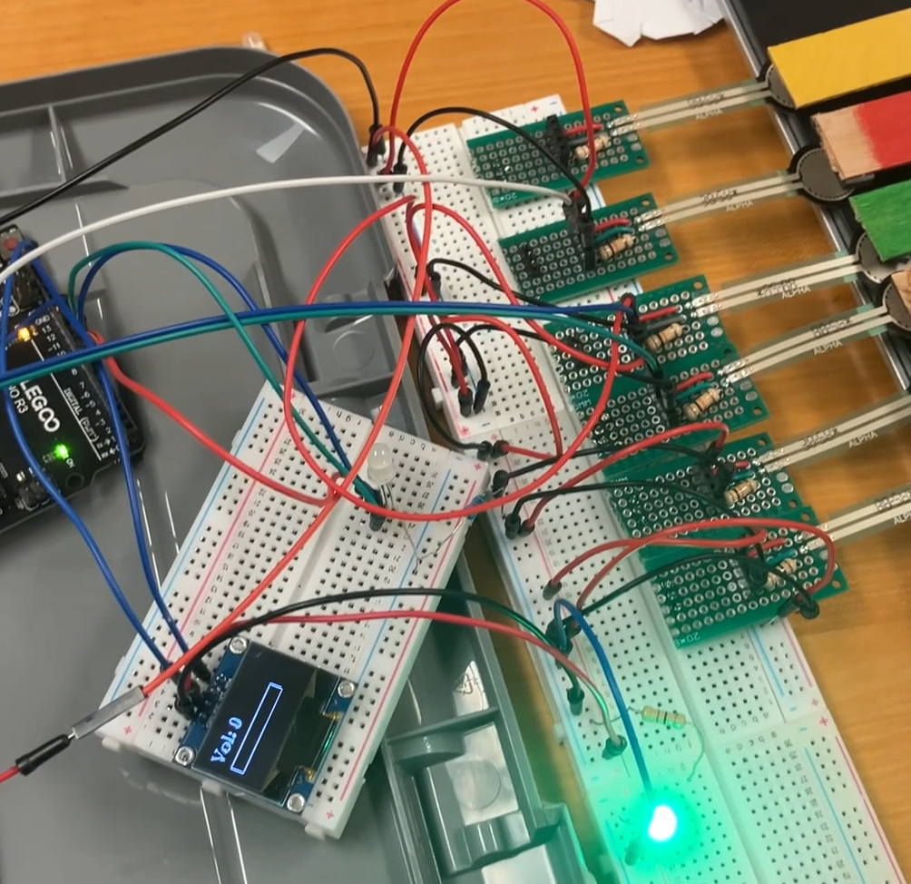

Final project for EE 1100A: EE Principles and Design (Spring 2026), built with Jacob Zilberstein. Instructor: E. Cosoroaba.

## Overview

This goal of this project was to build a polyphonic keyboard with inexpensive, off-the-shelf parts and a standard 8-bit Arduino Uno, about $70 in components.

The finished instrument reads force-sensitive resistors under each key, synthesizes audio in real time, and plays notes individually or as chords. Pressing a key harder makes that note louder in the mix. A potentiometer sets the master volume, an OLED shows the volume level, and an RGB LED shows how many notes are sounding.

The design called for eight keys (C4 to C5) read through a 16-channel analog multiplexer. Unfortunately, unreliable multiplexer breakout boards caused the project showcase to only utilize three keys wired straight to the Arduino's Uno's remaining three analog inputs. Future tests with Arduinos with larger numbers of analog inputs resulted in greater polyphony. 

## How it works

**Input sensing.** Each key is a popsicle-stick lever with a foam pad that presses on an Adafruit force sensor. Each sensor sits in a voltage divider with a 10 kΩ pulldown. As the press gets firmer, the sensor's resistance falls from over 20 MΩ to about 1 kΩ, and the divider voltage rises. That reading becomes the note's velocity.

**Audio synthesis.** Sound is generated with direct digital synthesis (DDS). A 256-entry, 8-bit sine table lives in flash, and each voice keeps a 16-bit phase accumulator. Timer1 fires an interrupt 16,000 times a second. On each tick, every active voice advances its accumulator by a per-note increment, `Δφ = f_note × 65536 / f_s`. The voice then looks up a sine sample, scales it by velocity, and adds it to the mix. The mix is scaled down by the number of active voices to prevent clipping, then by master volume.

**Audio output.** Timer2 outputs the mix as PWM on pin 11. A 1 kΩ / 0.01 µF RC low-pass filter (cutoff around 16 kHz) removes the 62.5 kHz PWM carrier. A PAM8403 class-D amplifier on its own 5 V supply then drives the speaker.

**Visual feedback.** A 128×64 I²C OLED shows volume as a number and a bar, refreshed about four times a second so the display doesn't starve the synthesis loop. The RGB LED glows green for one note, blue for two, and red for three or more.

## Picture

<figure>
  
  <figcaption>Protype circuit with five keys, though only three are connected to the Arduino due to limited analog ports. Display and status LED also visible.</figcaption>
</figure>
