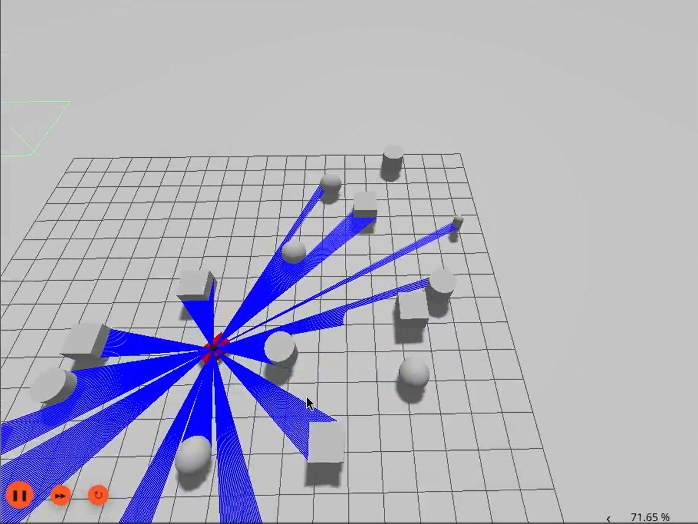
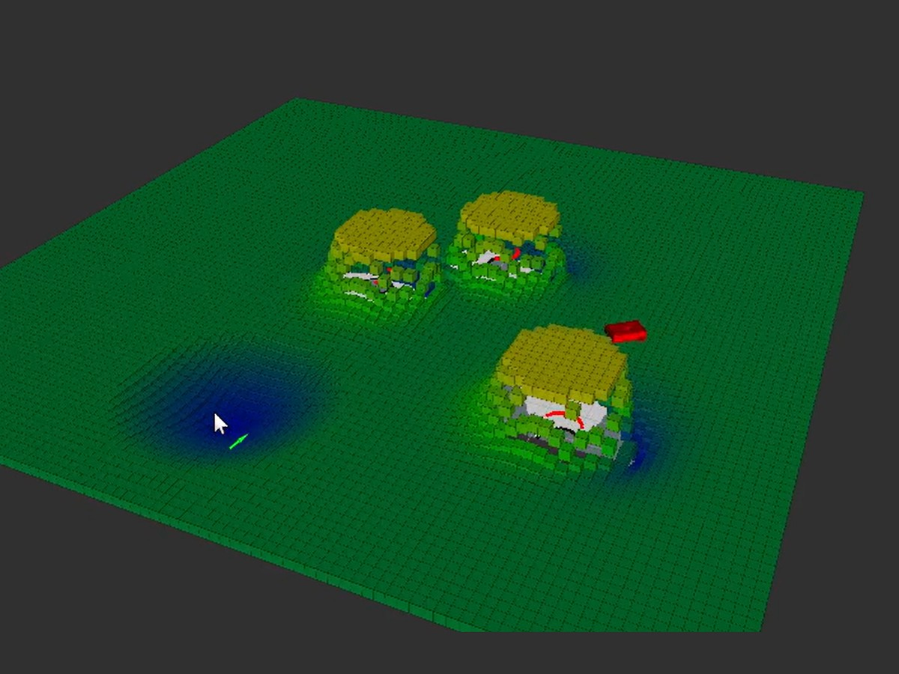
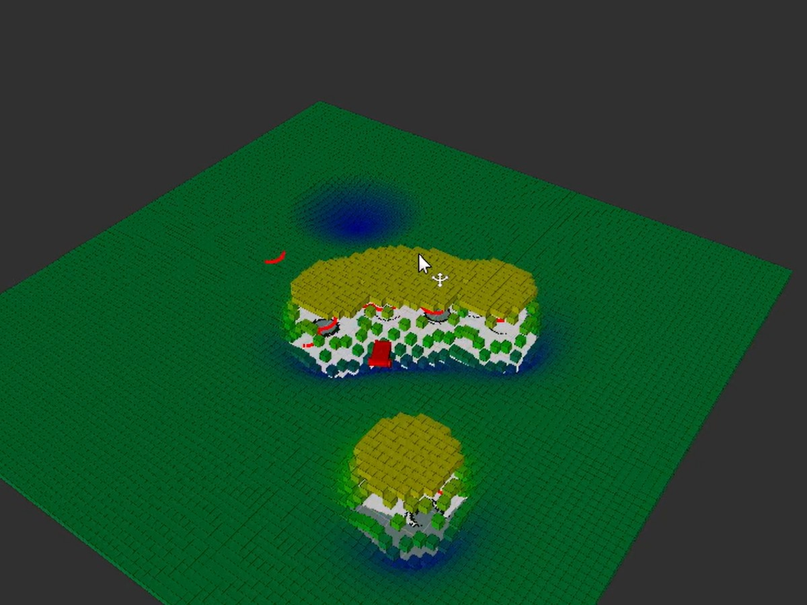

As an undergraduate researcher at UVM under Dr. Duffaut, I have been working on the robot's navigation. To learn ROS 2 and test control strategies, I created two simulators: a go-to-goal differential drive simulator, and a potential field controller that avoids obstacles using simulated LIDAR.

## Differential drive simulator

The simulator is split into three ROS 2 nodes that communicate over topics, the same way they would on a real robot.

<figure class="diagram">
<svg viewBox="0 0 720 230" role="img" aria-labelledby="dd-title">
  <title id="dd-title">Node graph: the visualizer publishes a goal pose to the controller; the controller publishes a velocity to the kinematics node; the kinematics node publishes the robot's pose back to the controller and the visualizer.</title>
  <defs>
    <marker id="dd-arrow" viewBox="0 0 10 10" refX="9" refY="5" markerWidth="7" markerHeight="7" orient="auto-start-reverse">
      <path d="M0,0 L10,5 L0,10 z" fill="currentColor"/>
    </marker>
  </defs>
  <g fill="none" stroke="currentColor" stroke-width="2" marker-end="url(#dd-arrow)">
    <path d="M190 70 H262"/>
    <path d="M450 70 H522"/>
    <path d="M610 100 V140 H360 V104"/>
    <path d="M610 100 V190 H100 V104"/>
  </g>
  <g class="node">
    <rect x="20" y="40" width="170" height="60" rx="8"/>
    <rect x="270" y="40" width="180" height="60" rx="8"/>
    <rect x="530" y="40" width="170" height="60" rx="8"/>
  </g>
  <g class="label" text-anchor="middle">
    <text x="105" y="67">Visualizer</text><text x="105" y="87" class="sub">draws poses, takes clicks</text>
    <text x="360" y="67">Controller</text><text x="360" y="87" class="sub">PD on pose error</text>
    <text x="615" y="67">Pose Solver</text><text x="615" y="87" class="sub">calculates robot pose</text>
  </g>
  <g class="edge" text-anchor="middle">
    <text x="228" y="60">goal pose</text>
    <text x="488" y="60">velocity</text>
    <text x="485" y="132">pose</text>
    <text x="355" y="182">pose</text>
  </g>
</svg>
</figure>

**Visualizer.** Draws the robot's pose and the current goal. Clicking anywhere in the window publishes a new goal pose at that point, so the robot can be sent anywhere interactively.

**Controller.** Subscribes to the goal pose and the robot's current pose, and computes a velocity command from the error between them. It's essentially a proportional controller, with a small derivative term to damp the approach.

**Kinematics.** Subscribes to the velocity command and the current pose, runs them through the differential drive kinematic model, and publishes the resulting pose. The model relates the robot's forward speed *v* and turning rate *ω* to how its position and heading change:

$$
\begin{bmatrix} \dot{x} \\ \dot{y} \\ \dot{\theta} \end{bmatrix}
=
\begin{bmatrix} \cos\theta & 0 \\ \sin\theta & 0 \\ 0 & 1 \end{bmatrix}
\begin{bmatrix} v \\ \omega \end{bmatrix}
$$

Because each piece is its own node, any one of them can be swapped out without touching the others. That turned out to matter for the next project.

## Potential field controller

Next, I replaced the go-to-goal controller with a potential field controller, reusing the same kinematics node to turn velocity commands into motion. In a potential field, the goal pulls the robot toward it, and obstacles push it away. The controller reads simulated LIDAR ranges to find nearby obstacles, sums the attractive and repulsive forces into a single vector, and outputs target angular and linear velocities.

I displayed everything first in Gazebo, but moved later to RViz as it is much cheaper computationally. I later also added a surface map showing the magnitude of the vector field at every point. The map makes the controller's behavior visible at a glance, as obstacles show up as peaks where the repulsive push is strongest, while the goal pose shows up as a depression that the robot "rolls" down into. The map also clearly demonstrated the limitations of potential field navigation, due to the creation of local minima that the robot can get trapped in. This most often happened when there were a few obstacles directly between the robot and the goal, as the attractive force would increase as the robot approached the obstacle and overpower the repulsive force, causing the robot to get stuck next to the obstacle.

  <figure>
    
    <figcaption>The first version in Gazebo, with simulated LIDAR rays in blue.</figcaption>
  </figure>
  <figure>
    
    <figcaption>The potential field's magnitude shown in RViz. Obstacles rise as peaks, with the goal located in the center of the blue depression. Other depressions can be seen (local minima) near some of the obstacles. </figcaption>
  </figure>
  <figure>
    
    <figcaption>The robot stuck in a local minima next to some obstacles between it and the goal.</figcaption>
  </figure>

## What's next

The end goal is to run these algorithms on the actual weeding robot. Building them in simulation first, however, allows me to see how these  has let me test ideas quickly, see exactly why something fails, and make mistakes that don’t cost hardware.